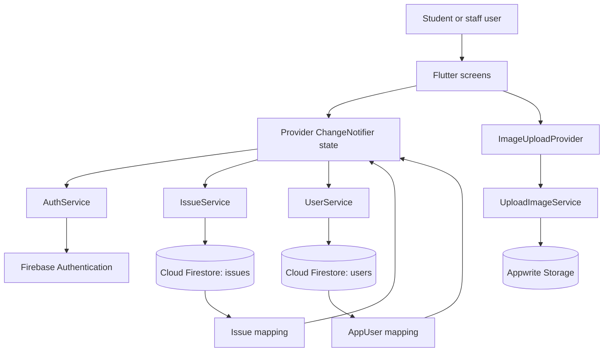
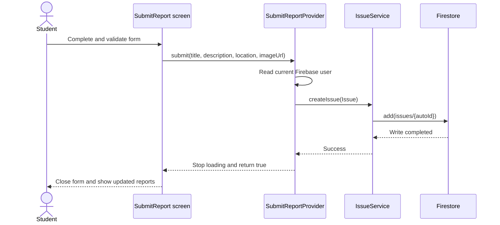
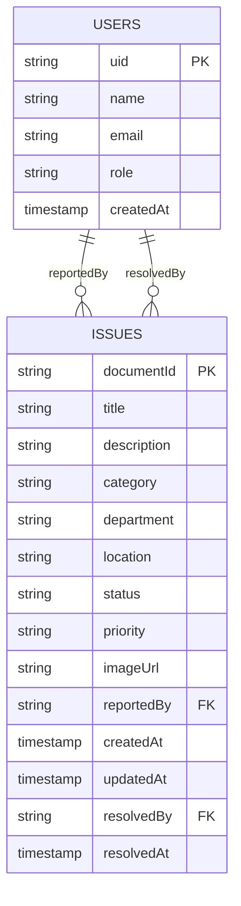

# CampusCare Application Architecture and Design Report

## 1. Executive summary

CampusCare (the project package is `mobile_dev_formative_assignment2`) is a Flutter mobile application for reporting and tracking campus facilities issues. Students can register, submit an issue with a category, priority, location, description and optional image, explore campus issues, and monitor their own report status. Staff can view issues ordered by urgency and update an issue through the submitted, in-progress and resolved lifecycle.

The application uses:

- Flutter and Material 3 for the cross-platform presentation layer.
- Firebase Authentication for email/password identity, with student accounts
  restricted to `@alustudent.com` addresses and mandatory email verification
  before access.
- Cloud Firestore for user profiles and issue records.
- Provider `ChangeNotifier` classes for screen-level state and asynchronous stream coordination.
- Appwrite Storage for compressed public report images.

The architecture is appropriate for a small-to-medium academic prototype because it separates UI, state orchestration, Firebase/Appwrite integration and data mapping. The most important production gap is server-side authorization: no Firestore or Appwrite security-rules files are included in the repository, so the client-side role and staff-code checks must not be treated as sufficient access control.

## 2. Scope and evidence

This report is based on the implementation in `lib/`, `pubspec.yaml`, `firebase.json`, the Android/iOS Firebase configuration, and the current test directory. Key evidence includes:

- Application bootstrap and routing: `lib/main.dart`, `lib/app_routes.dart`.
- Domain models: `lib/models/app_user.dart`, `lib/models/issue.dart`.
- Data access: `lib/services/auth_service.dart`, `lib/services/user_service.dart`, `lib/services/issue_service.dart`.
- State management: `lib/providers/`.
- Student and staff flows: `lib/screens/studentHome.dart`, `lib/screens/submit_report.dart`, `lib/screens/exploreIssues.dart`, `lib/screens/staff_dashboard.dart`, and `lib/screens/reportDetails.dart`.
- Image upload: `lib/services/upload_image.dart`.
- Validation evidence: the unit tests in `test/auth_service_test.dart` and
  `test/app_user_test.dart`, the widget tests in `test/widget_test.dart`, and
  the integration test in `integration_test/app_test.dart`.

No runtime screenshots or Firebase security-rules files are committed. Consequently, the screenshot section identifies the implemented UI surfaces and the recommended capture set without inventing runtime evidence.

## 3. Application architecture

### 3.1 Architectural style

The application follows a lightweight layered architecture:

1. **Presentation layer** — Flutter screens and reusable widgets render forms, cards, filters, dashboards and timelines.
2. **State/application layer** — Provider `ChangeNotifier` classes hold loading, filtering, submission and subscription state and expose user actions to the UI.
3. **Service/integration layer** — services encapsulate Firebase Auth, Firestore and Appwrite calls.
4. **Domain/data layer** — `AppUser` and `Issue` provide typed domain objects; enums provide stable persisted values and human-readable labels.
5. **Infrastructure/configuration** — Firebase initialization is in `main.dart`/`firebase_options.dart`; Appwrite upload configuration is loaded from the bundled `env.json`.



### 3.2 Request and state flow



### 3.3 Navigation and role routing

`AppRoutes` defines named routes for welcome, authentication, student home, report submission, explore, report details, staff dashboard, reports and profile. Student registration accepts only addresses ending in `@alustudent.com`;
staff registration accepts normal email addresses after the staff access-code
check. Registration sends Firebase's email-verification message and signs the
user out; sign-in resends the message and blocks navigation when the account is
not verified. After verification, `SignIn` reads the Firestore profile and
routes `teacher` users to the staff dashboard; all other users are routed to
the student home.

This is a clear prototype flow, but route visibility is not a security boundary. A user who can construct a route or call a service directly still requires Firestore rules to prevent unauthorized reads and writes.

## 4. Firebase data structure

### 4.1 Collections and relationships

The repository defines two Firestore collections: `users` and `issues`.



### 4.2 Firestore path examples

```text
users/{uid}
issues/{issueId}
```

`users/{uid}` uses the Firebase Auth UID as both the document ID and the stored `uid` field. `issues/{issueId}` uses a Firestore-generated document ID; the issue model deliberately does not duplicate that ID in `toMap()`.

### 4.3 User document

| Field | Type | Required | Meaning |
|---|---|---:|---|
| `uid` | string | Yes | Firebase Authentication UID |
| `name` | string | Yes | Display name |
| `email` | string | Yes | Account email |
| `role` | string | Yes | Persisted enum value: `student` or `teacher` |
| `createdAt` | timestamp | Yes | Profile creation time |

### 4.4 Issue document

| Field | Type | Required | Meaning |
|---|---|---:|---|
| `title` | string | Yes | Short issue heading |
| `description` | string | Yes | User-provided details; UI limits input to 500 characters |
| `category` | string | Yes | `water`, `electricity`, `furniture`, `sanitation`, `safety`, `facilities`, or `other` |
| `department` | string | No | Optional responsible department |
| `location` | string | Yes | Campus location |
| `status` | string | Yes | `submitted`, `in_progress`, or `resolved` |
| `priority` | string | Yes | `normal`, `high`, or `urgent` |
| `imageUrl` | string | No | Appwrite Storage view URL |
| `reportedBy` | string | Yes | UID of the reporting student |
| `createdAt` | timestamp | Yes | Creation time |
| `updatedAt` | timestamp | Yes | Last status update time |
| `resolvedBy` | string | No | UID of staff member who claimed/updated the issue |
| `resolvedAt` | timestamp | No | Time at which the issue was marked resolved |

The current service streams all issues for exploration/staff views and filters a student's reports with `where(reportedBy == uid)`. For larger datasets, add composite indexes and server-side filtering/pagination rather than downloading the whole `issues` collection.

## 5. State management approach and rationale

The project uses the `provider` package and `ChangeNotifier`. Providers are created close to the screens that own their state:

| Provider | Responsibility | Main state |
|---|---|---|
| `StudentHomeProvider` | Auth/user subscriptions and student dashboard metrics | name, reports, active/resolved counts, selected tab, loading/error |
| `ExploreIssuesProvider` | Live issue list, search, filters and urgency sorting | issue list, search query, category/status/priority filters |
| `SubmitReportProvider` | Report form selections and submission lifecycle | category, priority, submitting flag, error |
| `ImageUploadProvider` | Image selection/upload lifecycle | URL, uploading flag, error |

This approach is suitable because it:

- keeps widgets declarative (`context.watch` for rebuilds and `context.read` for actions);
- makes asynchronous loading and errors explicit;
- supports live Firestore streams;
- allows service injection in provider constructors, which improves unit-testability;
- avoids introducing a larger state framework for a compact application.

The main trade-off is that providers are screen-oriented rather than a single application state graph. Auth state is duplicated through service instances, and `AuthService`/`IssueService` are instantiated in several screens. A future version could centralize dependency injection and authentication/session state in an app-level provider.

## 6. User roles

The implemented roles are:

### Student

- Creates a student account with an `@alustudent.com` email, or a staff
  account with a normal email and valid staff access code, then sends a
  verification email before access is allowed.
- Submits campus issues.
- Views public/explorable campus issues.
- Views their own reports and status timeline.
- Can attach an image.

### Staff (`teacher` persisted value)

- Signs in through the same authentication flow and must have a verified
  email address. Student accounts must use an ALU email; staff accounts may
  use normal email addresses.
- Opens the staff dashboard.
- Sees issues sorted by urgency.
- Filters by priority and status.
- Updates issue status.
- Is recorded in `resolvedBy` when performing a status update.

There is no separate administrator role in the current model. There is also no server-maintained staff directory or approval workflow.

## 7. Access control and security assessment

### 7.1 Implemented application-level controls

- Firebase Authentication is required for registration and sign-in.
- A missing Firestore user profile causes sign-in to be rejected and the Firebase session to be signed out.
- Staff registration requires a local access-code comparison.
- Student report queries are scoped by `reportedBy`.
- Status updates use a Firestore transaction and refuse an update when another staff UID is already recorded in `resolvedBy`.
- UI routes differ by role after sign-in.

### 7.2 Required server-side controls

The repository contains no `firestore.rules`, `storage.rules`, or equivalent server-side authorization policy. Therefore, the following must be implemented before production deployment:

| Resource/action | Recommended rule |
|---|---|
| Read own user profile | Authenticated user may read `/users/{uid}` only when `{uid} == request.auth.uid` |
| Update own profile | Allow only approved profile fields; do not allow a user to change `role` |
| Create issue | Authenticated students may create only when `reportedBy == request.auth.uid`; force initial status and timestamps |
| Read issues | Decide explicitly whether all authenticated users may read public issue summaries or only staff/report owners |
| Update issue status | Staff-only custom claim or trusted role document; validate allowed state transitions and actor fields |
| Delete issue | Deny by default, or restrict to a trusted administrative process |
| Appwrite image upload | Restrict create/read permissions, file size and MIME type; avoid public read permissions if reports contain sensitive information |

The local staff access code in `staff_access.dart` is discoverable in a client bundle and is not a secure authorization mechanism. Replace it with invitation, admin approval, or Firebase custom claims set by a trusted backend/Cloud Function. Role changes must never be accepted from an untrusted client.

## 8. UI/UX decisions

The UI uses a calm campus-service visual language:

- Material 3 with a blue seeded color scheme.
- A light background, surface cards, rounded corners and outlined inputs.
- Large headings and short explanatory copy on welcome and dashboard screens.
- Status badges and color-coded status states: warning for submitted, blue for in progress, and green for resolved.
- Search and chip-based filters on explore/staff views.
- Pull-to-refresh and explicit loading, empty and error states.
- A three-step report timeline: submitted, in progress, resolved.
- Form validation and disabled submit/back controls during asynchronous submission.
- Compressed JPEG uploads (1600x1200 target, quality 75) to reduce payload size.
- Semantic labeling on the main report prompt and tooltips on key icon buttons.

These decisions reduce cognitive load and make the primary task—reporting an issue—visible from the student home screen. The current design should still be tested with real users for contrast, text scaling, screen-reader focus order, image failure states, and small-screen keyboard behavior.

## 9. Data models

### 9.1 `AppUser`

`AppUser` is immutable and contains `uid`, `name`, `email`, `role` and `createdAt`. `fromMap` converts Firestore timestamps and applies safe defaults for missing strings. `toMap` persists the role's stable storage value rather than the display label.

### 9.2 `Issue`

`Issue` is immutable and contains report content, classification, ownership, timestamps and resolution metadata. Enum values are persisted as stable strings through `IssueCategory`, `IssueStatus`, `Priority` and `UserRole`.

`Issue.copyWith` intentionally exposes only staff-editable fields: status, priority, update time and resolution metadata. Its documented limitation is that nullable fields cannot currently be reset to `null`; this matters if reassignment or reopening is added later.

### 9.3 Data integrity recommendations

- Validate field lengths and allowed enum values in Firestore rules, not only in Flutter forms.
- Use `FieldValue.serverTimestamp()` for issue creation and updates to avoid device-clock inconsistency.
- Add an immutable audit subcollection or event log for status changes if accountability is required.
- Consider storing a display-safe image path/file ID rather than a permanently public URL.
- Add explicit `department` capture or remove the unused field until routing is implemented.

## 10. Testing and verification

### 10.1 Implemented testing plan

The project now contains a small, layered test suite that exercises stable
business logic and the initial user journey without requiring live Firebase
credentials:

| Level | File | Coverage |
|---|---|---|
| Unit | `test/auth_service_test.dart` | Accepts valid ALU student addresses case-insensitively and rejects non-ALU, malformed and multi-domain addresses. |
| Unit | `test/app_user_test.dart` | Verifies that an `AppUser` can be converted to the Firestore map representation and reconstructed with its identity, role and timestamp. |
| Widget | `test/widget_test.dart` | Verifies the Welcome screen’s branding and primary actions, and confirms that “Get started” navigates to the sign-up route. |
| Integration | `integration_test/app_test.dart` | Launches `MyApp` and verifies that the application opens on the CampusCare Welcome screen with its main actions visible. |

The integration test uses the real application bootstrap and iOS simulator
build, while the widget tests use a small in-memory `MaterialApp` route setup
so they remain deterministic and do not call Firebase.

### 10.2 Verification results

The focused unit and widget command completed successfully:

```text
flutter test test/auth_service_test.dart test/app_user_test.dart test/widget_test.dart
5 tests passed
```

The integration command also completed successfully on the iOS simulator:

```text
flutter test integration_test/app_test.dart
1 test passed
```

`integration_test` was added as a Flutter SDK development dependency. An
additional `flutter analyze` attempt could not complete because the local
Flutter installation was missing
`analysis_server_aot.dart.snapshot`; this is a toolchain limitation and not a
test failure.

### 10.3 Future test expansion

The current suite is intentionally small. The next useful additions are:

| Area | Planned coverage |
|---|---|
| Provider | Loading, success and error states; unauthenticated submission; image upload failure; subscription cleanup. |
| Service | Mocked Firebase Auth/Firestore reads and writes, including issue-claim transactions. |
| Widget | Sign-up and sign-in validation, report form validation, filters, and loading/empty/error states. |
| Integration | Firebase Auth and Firestore emulator flows, student report isolation, staff status updates and concurrent assignment. |
| Security | Firestore Rules Simulator role/action matrix and Appwrite bucket permissions. |
| Accessibility | Text scaling, screen-reader labels, contrast, keyboard navigation and offline/retry behavior. |

## 11. Challenges, limitations and future improvements

### Challenges addressed

- Coordinating live Firestore streams with screen lifecycle and disposal.
- Preventing two staff members from claiming the same issue through a transaction.
- Providing useful loading, empty and error states instead of silently failing.
- Compressing and uploading images while handling picker, timeout and Appwrite errors.
- Keeping persisted enum values stable while allowing UI labels to change.

### Current limitations

1. Server-side Firebase/Appwrite rules are not included.
2. The staff access code is client-visible and therefore not a secure role gate.
3. The current automated suite focuses on core mapping and the initial
   welcome flow; provider, service, security-rule and end-to-end data-flow
   tests remain future work.
4. All-issue streams may not scale without pagination or query constraints.
5. Status history is inferred from current fields; there is no audit trail.
6. The public Appwrite view URL may expose report images beyond intended users.
7. There is no explicit offline queue or conflict-resolution UX.
8. The app has no administrator role, moderation workflow or report deletion policy.
9. The student role fallback in enum parsing is convenient for malformed data but could conceal a bad role value; production rules should reject invalid role strings.

### Prioritized improvements

1. Add and test Firestore/Appwrite security rules.
2. Replace the client access code with trusted staff provisioning/custom claims.
3. Expand the implemented test foundation with provider, service,
   integration-emulator and security-rule tests.
4. Add server timestamps, pagination and indexes.
5. Add an issue-status history subcollection and notification mechanism.
6. Centralize dependencies and auth/session state.

## 12. Screenshot and diagram evidence plan

The repository does not contain captured runtime screenshots. The following capture set should be produced on an emulator or physical device for the final submission:

| Figure | Screen | What it demonstrates |
|---:|---|---|
| 1 | Welcome screen | Product purpose, primary “Get started” action and sign-in alternative |
| 2 | Student home | Impact metrics, recent reports and report prompt |
| 3 | Submit report | Validated issue form, category/priority selection and image attachment |
| 4 | Explore issues | Live issue cards, search, category/status filters and empty/error states |
| 5 | Report details | Image, location, status badge and status timeline |
| 6 | Staff dashboard | Urgency ordering, staff filters and assignment/update affordance |
| 7 | Staff status update | Allowed status selection and assigned-to-another-staff behavior |

The diagrams in Sections 3 and 4 are implementation-grounded architecture/data-model diagrams and can be rendered from Mermaid in the final document.

## 13. References (APA 7th edition)

Dart. (n.d.). *Dart documentation*. https://dart.dev/

Flutter. (n.d.). *Flutter documentation*. https://docs.flutter.dev/

Flutter team. (n.d.). *Provider package*. pub.dev. https://pub.dev/packages/provider

Google. (n.d.-a). *Cloud Firestore documentation*. Firebase. https://firebase.google.com/docs/firestore

Google. (n.d.-b). *Firebase Authentication documentation*. Firebase. https://firebase.google.com/docs/auth

Google. (n.d.-c). *Cloud Firestore security rules conditions*. Firebase. https://firebase.google.com/docs/firestore/security/rules-conditions

Google. (n.d.-d). *Get started with Firebase in Flutter*. Firebase. https://firebase.google.com/docs/flutter/setup

Appwrite. (n.d.). *Storage API documentation*. https://appwrite.io/docs/products/storage
